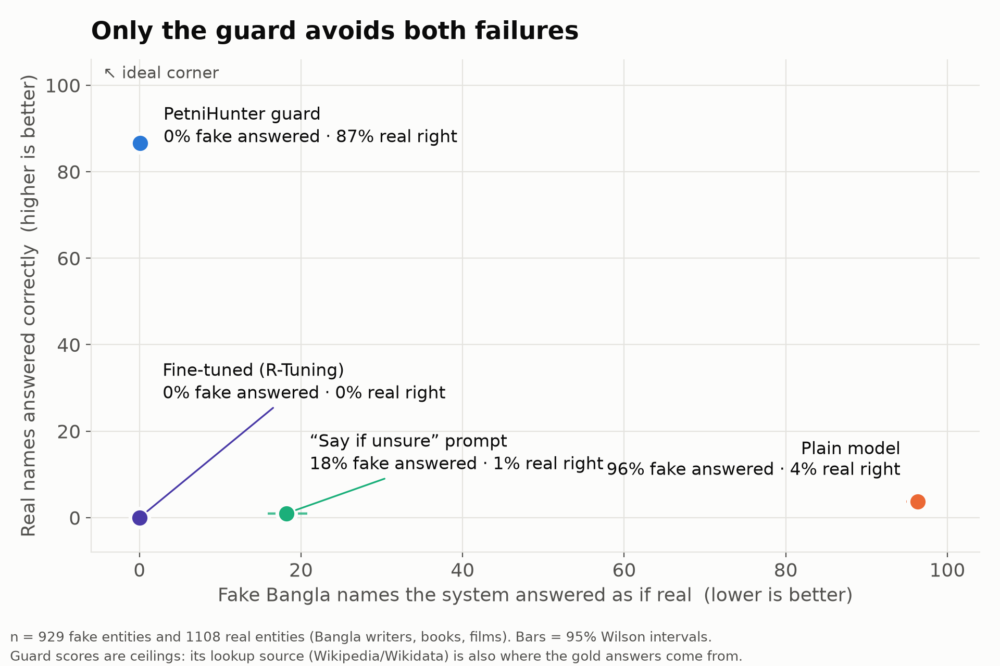
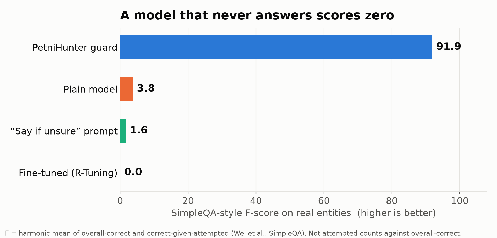
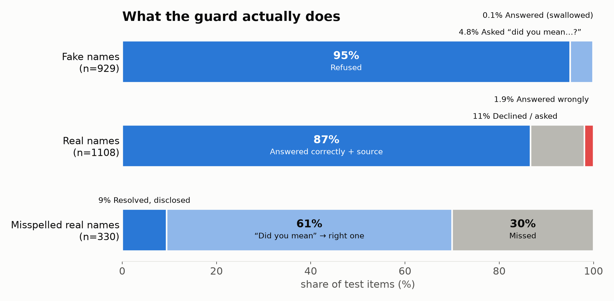

# 👻 PetniHunter — পেত্নী শিকারি

**Hunting *ghost entities* in Bangla AI — and acting on them.**

A *ghost entity* is a person, book or film that does not exist, but that a language model will happily describe.
Ask a small open model who wrote an invented Bangla novel and it names an author, a year and a plot — with no hint of doubt.
PetniHunter sits in front of the model, checks the entity against Bangla Wikipedia and Wikidata, and then **acts**:

| Situation | What PetniHunter does |
|---|---|
| The thing does not exist | 🛑 **Refuse** — "I found nothing reliable, so I will not guess." |
| It is close to something real (typo, spelling variant) | ❓ **Redirect** — "Did you mean *X*?" It never silently answers about *X*. |
| It exists | ✅ **Rescue** — answers from Wikidata, with a source link, and says which page it used. |

> *পেত্নী* (petni) is a female ghost from Bengali folklore. This project hunts the phantoms a model conjures out of thin air.

Built for the DEV **Hacktoberfest "Ghost in the Machine"** challenge. Open-weight model at the core: **Qwen3.5-4B**, run and fine-tuned through **Tinker**.



## Results (2,367 test items, Bangla writers / books / films)

Metrics follow existing benchmarks instead of home-made ones:
**False Acceptance Rate** on non-existent entities ([HalluLens](https://arxiv.org/abs/2504.17550), Meta) and **correct / incorrect / not attempted + F-score** ([SimpleQA](https://arxiv.org/abs/2411.04368), OpenAI). 95% Wilson intervals.

| System | Fake names answered as real ↓ | Real names correct ↑ | Real names wrong ↓ | Not attempted | F-score ↑ |
|---|---|---|---|---|---|
| Plain Qwen3.5-4B | 96.3% [94.9–97.4] | 3.7% | 93.4% | 2.9% | 3.8 |
| + "say if unsure" prompt | 18.2% [15.8–20.8] | 1.0% | 19.7% | 79.3% | 1.6 |
| Fine-tuned to say "I don't know" (R-Tuning style) | 0.0% [0.0–0.4] | 0.0% | 0.0% | 100% | 0.0 |
| **PetniHunter guard** | **0.1%** [0.0–0.6] | **86.6%** [84.5–88.5] | 1.9% | 11.5% | **91.9** |

- The two "obvious" fixes **fail**: prompting makes the model refuse 79% of *real* entities, and fine-tuning makes it refuse **everything**. (The 4B model knows almost nothing about obscure Bangla names, so it has nothing to learn "when I know" from — only 35 of 2,427 training targets were real answers.)
- Misspelled real names (330 items): **70%** handled correctly — 200 got a correct "did you mean…?", 31 were resolved with disclosure, 99 were missed. No misspelling was silently answered as a *different* entity.
- Guard accuracy by type: writers 91.9%, books 87.8%, films 81.4%.




Full tables: [`results/tables.md`](results/tables.md). Raw outputs for every system: [`results/`](results/).

## ⚠️ Read these numbers with care

- **The guard's scores are ceilings, not general claims.** Gold answers come from Wikidata and the guard looks things up in Wikipedia/Wikidata. A near-perfect score on clean entities is partly by construction.
- **The ghosts are partly self-fulfilling.** I kept only invented names that a Bangla Wikipedia search could not find — the same search the guard uses. Refusing them is therefore almost guaranteed. Spliced-name ghosts (HalluLens's *MixedEntities*) control for name *style* (a name-shape classifier scores ~chance on them, AUC 0.46–0.62, vs 0.72–0.80 on LLM-invented names) but not for this.
- **Homonyms are the real hard case.** On the *train* split, before I added an entity-type check, 5 of 1,005 ghosts matched a real person with the same name. The check fixed that; on test, the one surviving "ghost" (*প্রতিশ্রুতি*, "Promise") is a common word that is also a real 2001 film.
- **The guard was changed once after I saw a demo failure** (redirect candidates were not type-checked). The test set was therefore run twice. Both runs are saved (`results/guard_v1.jsonl`, `results/guard.jsonl`); the fix improved misspelling handling 65.2% → 70.0% and changed nothing else.
- **My answer checker is rule-based** (Bangla spelling folding, not an LLM judge) and has known false "wrong"s (e.g. an invisible character in a name; Wikidata listing two birth years). A blind human audit of 100 outputs measures its agreement — see below.
- Writers, books and films only; needs internet; Bangla Wikipedia coverage limits what it can rescue (11.5% of real names go unanswered).

## Try it

```bash
python3 -m venv .venv && . .venv/bin/activate
pip install -r requirements.txt
cp .env.example .env          # put your TINKER_API_KEY in .env (never commit it)
python -m petnihunter.app     # http://127.0.0.1:8780
```

As a library:

```python
from petnihunter import answer

answer("'নিশিগন্ধার দিনলিপি' উপন্যাসটি কে লিখেছেন?")
# {'action': 'refuse', 'text': "...খুঁজে পাইনি, তাই অনুমান করে উত্তর দিচ্ছি না।",
#  'text_en': "I found nothing reliable named '...' on Bangla Wikipedia, so I will not guess.", ...}
```

Free-form questions work: Qwen extracts the name and what is asked (birth year / author / director); the six standard phrasings use a deterministic fast path. The web page shows the raw model answer, the Wikipedia check and the action side by side, with English translations (guard messages are templated; the raw model answer is machine-translated and labelled).

## How it works

```
question ──► extract (entity, property) ──► bn.wikipedia search (spelling-tolerant, with "did you mean")
          ──► title similarity (Bangla spelling-folded) + Wikidata type check (writer / book / film)
          ──► REFUSE | REDIRECT ("did you mean X?") | RESCUE (Wikidata fact + source, resolved name disclosed)
```

Design rules: a network failure is **never** treated as "does not exist" (it is an explicit `error`); several same-name candidates → ask which one; a redirect never answers about the suggested entity.

## Reproduce the experiment

```bash
python scripts/fetch_real.py        # real writers/books/Bengali films from Wikidata
python scripts/gen_ghosts.py        # Qwen-invented ghosts, filtered against bn.wikipedia
python scripts/gen_recomb.py        # spliced-name ghosts (HalluLens "MixedEntities")
python scripts/build_dataset.py     # splits; films are a held-out type, phrasing B is held out
python scripts/shortcut_check.py    # can a name-shape classifier tell real from ghost?
python scripts/eval_arm.py c0       # plain model;  c1 = + prompt
python scripts/train_sft.py 3       # R-Tuning-style LoRA fine-tune on Tinker -> c2
python scripts/eval_arm.py c2 "$(cat results/c2_path.txt)"
python scripts/eval_guard.py test && python scripts/retry_errors.py
python scripts/report_standard.py && python scripts/make_charts.py
```

## Human audit

`audit/output_audit.md` is a blind sheet of 100 sampled outputs; `scripts/audit_score.py` reports how often the automatic checker agrees with a human reading.

> **[AUDIT RESULT — fill in after the audit, or delete this section if it is not done]**

## Deploy

- **Static recorded demo** (no key, no server): publish `docs/` with GitHub Pages.
- **Live app**: `render.yaml` is included (Render → New → Blueprint). Set `TINKER_API_KEY` in the dashboard. Requests are rate-limited per IP and per day because the key costs money.

## Related work

HalluLens (Bang et al., 2025) · SimpleQA (Wei et al., 2024) · R-Tuning (Zhang et al., 2024) · BenHalluEval, a Bengali hallucination benchmark (2026) — which tests generated-text faithfulness, not entity existence, and complements this work.

## Layout

`petnihunter/` guard, LLM wrapper and web app · `scripts/` data, training, evaluation, charts, video · `results/` raw outputs and tables · `docs/` demo page and charts · `audit/` human-audit sheets · `video/` demo video.

## Credits & licence

Qwen3.5 (Alibaba, open weights) · Tinker (Thinking Machines) · Wikipedia & Wikidata (CC BY-SA / CC0) · Creepster font (SIL OFL).
**Licence: _to be chosen by the author before publishing._**
